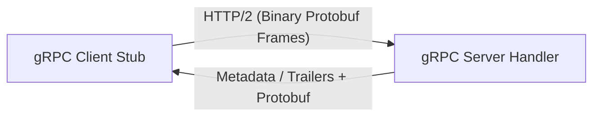

# GRPC-Learning: Complete gRPC Mastery Course in Pure JavaScript (Node.js)

A production-grade, hands-on learning repository for **gRPC** (Google Remote Procedure Call) and **Protocol Buffers**, built entirely with **Node.js LTS and pure JavaScript (CommonJS)** — zero TypeScript, zero build steps, and 100% executable code.

This repository combines a contract-first mental model with working implementations of all four gRPC streaming patterns, production resilience (deadlines, retries, auth, TLS), microservices orchestration, and automated testing with Jest.

---

## Table of Contents

1. [Project Overview](#1-project-overview)
2. [gRPC Fundamentals & Mental Model](#2-grpc-fundamentals--mental-model)
3. [gRPC vs REST / JSON](#3-grpc-vs-rest--json)
4. [Architecture & Request Flow](#4-architecture--request-flow)
5. [Repository Layout](#5-repository-layout)
6. [Prerequisites & Installation](#6-prerequisites--installation)
7. [Running Your First Example](#7-running-your-first-example)
8. [Lesson Index & Execution Commands](#8-lesson-index--execution-commands)
9. [Debugging with grpcurl](#9-debugging-with-grpcurl)
10. [Integrated Microservices Project (grpc-commerce-demo)](#10-integrated-microservices-project-grpc-commerce-demo)
11. [Automated Testing Suite](#11-automated-testing-suite)
12. [Docker & Containerized Deployment](#12-docker--containerized-deployment)
13. [Troubleshooting & Gotchas](#13-troubleshooting--gotchas)
14. [Learning Roadmap](#14-learning-roadmap)
15. [Interview Questions & Deep-Dive Answers](#15-interview-questions--deep-dive-answers)
16. [Hands-On Exercises & Solutions](#16-hands-on-exercises--solutions)
17. [Glossary & References](#17-glossary--references)

---

## 1. Project Overview

This repository is designed around an active learning loop:
**Read the `.proto` contract → Run the server & client → Break it on purpose → Verify status codes & network behavior.**

### Core Philosophy
- **Pure JavaScript Only**: CommonJS (`require` / `module.exports`) with standard Node.js LTS. No TypeScript, no transpilation, no compilation lag.
- **Dynamic Protobuf Compilation**: Contracts loaded at runtime via `@grpc/proto-loader`.
- **Zero Comments in Code**: The codebase is intentionally structured for self-documenting clarity. All theoretical explanations and design decisions reside in Markdown documentation.
- **Production-Ready Patterns**: Real JWT token parsing, X.509 TLS certificate generation, exponential backoff with jitter, idempotency deduplication, and standard health checks.

---

## 2. gRPC Fundamentals & Mental Model

gRPC is an open-source, high-performance RPC framework initially designed by Google.



### Key Pillars
1. **Protocol Buffers (Protobuf)**: A language-neutral, platform-neutral binary serialization mechanism. Messages are serialized into compact byte sequences defined by tag numbers rather than key strings.
2. **HTTP/2 Transport**:
   - **Multiplexing**: Hundreds of concurrent RPCs share a single persistent TCP connection.
   - **Binary Framing**: Separate HEADERS, DATA, and RST_STREAM frames.
   - **Header Compression (HPACK)**: Drastically reduces header overhead on repeated calls.
3. **The Four RPC Patterns**:
   - **Unary RPC**: Single request $\rightarrow$ Single response.
   - **Server Streaming RPC**: Single request $\rightarrow$ Continuous stream of responses.
   - **Client Streaming RPC**: Continuous stream of requests $\rightarrow$ Single aggregated response.
   - **Bidirectional Streaming RPC**: Concurrent, independent request and response streams.

---

## 3. gRPC vs REST / JSON

| Dimension | gRPC | REST / JSON |
| :--- | :--- | :--- |
| **Protocol** | HTTP/2 (Mandatory) | HTTP/1.1 or HTTP/2 |
| **Data Format** | Binary Protocol Buffers (Strict schema) | Textual JSON (Loose or OpenAPI schema) |
| **Streaming** | Native 4-way streaming over 1 TCP connection | Unidirectional SSE or separate WebSockets |
| **Contract** | First-class `.proto` source of truth | Secondary OpenAPI / Swagger documents |
| **Performance** | Extremely high throughput, low latency & CPU | Higher serialization overhead and bandwidth |
| **Call Semantics** | Native Deadlines, Trailers, Cancellation | Custom headers, hand-rolled timeout logic |
| **Browser Support** | Requires Envoy proxy / `grpc-web` | Universally supported by browser `fetch` |
| **Ideal For** | High-throughput internal microservices | Public APIs, mobile Web frontends |

---

## 4. Architecture & Request Flow

```mermaid
flowchart TD
    subgraph ClientProcess ["Client Application"]
        ClientApp["Client Code"] --> LoggingInterceptor["Logging Interceptor"]
        LoggingInterceptor --> AuthInterceptor["Auth Interceptor (Bearer JWT)"]
        AuthInterceptor --> gRPCStub["gRPC Client Stub"]
    end

    subgraph Wire ["HTTP/2 Connection"]
        gRPCStub ==>|HEADERS (Authorization, Tracing)| HTTP2Transport["TCP / TLS Socket"]
        HTTP2Transport ==>|DATA (Protobuf Payload)| ServerRuntime["gRPC Server Engine"]
    end

    subgraph ServerProcess ["Server Application"]
        ServerRuntime --> HealthCheck["grpc.health.v1.Health"]
        ServerRuntime --> Reflection["grpc.reflection.v1alpha"]
        ServerRuntime --> MethodHandler["Business Method Handler"]
        MethodHandler --> DataStore["Repository / In-Memory DB"]
    end
```

---

## 5. Repository Layout

```
GRPC-Learning/
├── .github/workflows/ci.yml       # GitHub Actions CI matrix
├── docker/
│   ├── Dockerfile                 # Node.js Alpine production container
│   └── docker-compose.yml         # Multi-service cluster topology
├── docs/
│   ├── architecture.md            # Deep architecture & HTTP/2 framing
│   ├── troubleshooting.md         # Status codes & debug playbooks
│   ├── glossary.md                # gRPC & distributed systems glossary
│   └── learning-roadmap.md        # 4-stage mastery guide
├── lessons/
│   ├── 01-grpc-fundamentals/      # Hello World & core mechanics
│   ├── 02-protocol-buffers/       # Wire types, enums, oneof, evolution
│   ├── 03-unary-rpc/              # Complete UserService with CRUD
│   ├── 04-server-streaming/       # Live notification push stream
│   ├── 05-client-streaming/       # High-frequency sensor ingestion
│   ├── 06-bidirectional-streaming/# Real-time duplex chat room
│   ├── 07-deadlines-and-timeouts/ # Deadlines, timeouts & abort handling
│   ├── 08-error-handling/         # Standard error catalog & status codes
│   ├── 09-metadata-and-interceptors/ # Tracing headers & client interceptors
│   ├── 10-authentication-and-authorization/ # JWT metadata authentication
│   ├── 11-tls-and-security/       # X.509 TLS certificate generation & mTLS
│   ├── 12-cancellation-and-retries/ # Exponential backoff with jitter
│   ├── 13-health-checking/        # grpc.health.v1 implementation
│   ├── 14-reflection-and-debugging/ # Dynamic server reflection & grpcurl
│   ├── 15-load-balancing/         # Multi-backend round-robin balancing
│   ├── 16-rest-vs-grpc/           # Express vs gRPC performance benchmark
│   ├── 17-database-integration/   # Relational entity store & pagination
│   ├── 18-microservices/          # grpc-commerce-demo 3-tier cluster
│   ├── 19-testing/                # Ephemeral port testing strategies
│   ├── 20-docker-and-deployment/  # Docker & Kubernetes readiness guide
│   └── 21-production-best-practices/ # Production hardened server template
├── proto/                         # Strict Protocol Buffer contracts
├── src/                           # Shared runtime utilities & interceptors
├── tests/                         # 21 Jest automated test suites
├── scripts/check-protos.js        # Protobuf schema syntax validator
└── package.json                   # CommonJS npm scripts & configuration
```

---

## 6. Prerequisites & Installation

### Prerequisites
- **Node.js**: LTS version (v18.0.0 or higher) — check with `node -v`
- **npm**: v9.0.0 or higher — check with `npm -v`

### Installation
Clone the repository and install all dependencies:
```bash
git clone https://github.com/Ankitmohanty2/GRPC-Learning.git
cd GRPC-Learning
npm install
```

---

## 7. Running Your First Example

Start the Hello World gRPC server in your first terminal:
```bash
npm run lesson:01:server
```

In a second terminal, invoke the client:
```bash
npm run lesson:01:client Alice
```

Expected Output:
```
🎉 Server says: Hello, Alice!
```

---

## 8. Lesson Index & Execution Commands

| # | Lesson Topic | Server Command | Client / Demo Command |
|---|:---|:---|:---|
| 01 | **gRPC Fundamentals** | `npm run lesson:01:server` | `npm run lesson:01:client` |
| 02 | **Protocol Buffers** | `npm run lesson:02:server` | `npm run lesson:02:client` |
| 03 | **Unary RPC** | `npm run lesson:03:server` | `npm run lesson:03:client` |
| 04 | **Server Streaming** | `npm run lesson:04:server` | `npm run lesson:04:client` |
| 05 | **Client Streaming** | `npm run lesson:05:server` | `npm run lesson:05:client` |
| 06 | **Bidirectional Streaming**| `npm run lesson:06:server` | `npm run lesson:06:client` |
| 07 | **Deadlines & Timeouts** | `npm run lesson:07:server` | `npm run lesson:07:client` |
| 08 | **Error Handling** | `npm run lesson:08:server` | `npm run lesson:08:client` |
| 09 | **Metadata & Interceptors**| `npm run lesson:09:server` | `npm run lesson:09:client` |
| 10 | **Authentication (JWT)** | `npm run lesson:10:server` | `npm run lesson:10:client` |
| 11 | **TLS & Encryption** | `npm run lesson:11:server` | `npm run lesson:11:client` |
| 12 | **Cancellation & Retries** | `npm run lesson:12:server` | `npm run lesson:12:client` |
| 13 | **Health Checking** | `npm run lesson:13:server` | `npm run lesson:13:client` |
| 14 | **Server Reflection** | — | `npm run lesson:14:demo` |
| 15 | **Load Balancing** | — | `npm run lesson:15:demo` |
| 16 | **REST vs gRPC Benchmark** | — | `npm run lesson:16:compare` |
| 17 | **Database Integration** | — | `npm run lesson:17:demo` |
| 18 | **Microservices Cluster** | `npm run microservices:start` | `npm run microservices:client` |
| 19 | **Programmatic Testing** | — | `node lessons/19-testing/demo.js` |
| 20 | **Docker Deployment** | `npm run docker:up` | `npm run docker:down` |
| 21 | **Production Server** | `node lessons/21-production-best-practices/production-server.js` | — |

---

## 9. Debugging with grpcurl

`grpcurl` is the `curl` equivalent for gRPC servers that expose Server Reflection:

### 1. List Available Services
```bash
grpcurl -plaintext 127.0.0.1:50051 list
```
Output:
```
grpc.health.v1.Health
grpc.reflection.v1alpha.ServerReflection
helloworld.Greeter
```

### 2. Describe a Specific Service Contract
```bash
grpcurl -plaintext 127.0.0.1:50051 describe helloworld.Greeter
```

### 3. Invoke a Remote Procedure Call Directly
```bash
grpcurl -plaintext -d '{"name": "DevOps"}' 127.0.0.1:50051 helloworld.Greeter/SayHello
```
Output:
```json
{
  "message": "Hello, DevOps!"
}
```

---

## 10. Integrated Microservices Project (grpc-commerce-demo)

Lesson 18 contains a distributed e-commerce workflow orchestrating three microservices:
1. **User Service** (`:50051`): Identity and account verification.
2. **Product Service** (`:50052`): Catalog and stock validation.
3. **Order Service** (`:50053`): Order placement, downstream orchestration, and idempotency deduplication.

### Run the Cluster:
```bash
npm run microservices:start
```
In another terminal, trigger the client flow:
```bash
npm run microservices:client
```

---

## 11. Automated Testing Suite

Automated testing is powered by **Jest** with dynamic ephemeral port binding (`127.0.0.1:0`), ensuring tests never collide on TCP sockets.

### Run All 21 Test Suites:
```bash
npm test
```

### Validate Protocol Buffer Schemas:
```bash
npm run proto:check
```

### Run ESLint Code Quality:
```bash
npm run lint
```

---

## 12. Docker & Containerized Deployment

Run the complete microservices cluster in Docker Compose:
```bash
npm run docker:up
```

View active container logs:
```bash
docker compose -f docker/docker-compose.yml logs -f
```

Tear down containers:
```bash
npm run docker:down
```

---

## 13. Troubleshooting & Gotchas

1. **`14 UNAVAILABLE: No connection established`**:
   - The server was not listening when the client connected. Ensure the server is bound before calling RPCs.
2. **`4 DEADLINE_EXCEEDED`**:
   - The RPC handler did not complete within the requested time window (`deadline: Date.now() + ms`).
3. **`12 UNIMPLEMENTED: Method not found`**:
   - Case sensitivity mismatch between `.proto` definition and the JavaScript implementation object.
4. **Port Collisions in Tests (`EADDRINUSE`)**:
   - Always bind to port `0` (`127.0.0.1:0`) in tests so the operating system allocates a free ephemeral port.
5. **Open Handles / Hang on Exit**:
   - gRPC HTTP/2 connections stay open indefinitely unless closed. Always invoke `client.close()` and `server.tryShutdown()` in cleanup hooks.

---

## 14. Learning Roadmap

Check out the full four-stage curriculum in [docs/learning-roadmap.md](docs/learning-roadmap.md):
- **Stage 1: Fundamentals & Protocol Buffers** (Lessons 01–03)
- **Stage 2: Streaming Patterns & Backpressure** (Lessons 04–06)
- **Stage 3: Reliability, Security & Observability** (Lessons 07–15)
- **Stage 4: Enterprise Microservices & Operations** (Lessons 16–21)

---

## 15. Interview Questions & Deep-Dive Answers

<details>
<summary><b>1. Why does gRPC use HTTP/2 instead of HTTP/1.1?</b></summary>
HTTP/1.1 suffers from Head-of-Line (HoL) blocking at the application layer: each request must wait for the preceding response before the connection can be reused (unless multiple TCP connections are opened). HTTP/2 introduces binary framing and multiplexed bidirectional streams over a single TCP connection, allowing concurrent requests and responses without connection overhead.
</details>

<details>
<summary><b>2. Why can't you change a Protobuf field number after publication?</b></summary>
Protobuf does not transmit field names over the wire; it encodes the tag number and wire type. Changing tag number `1` to `2` causes deserializers to map incoming bytes to the wrong field or treat them as unknown fields, breaking backward and forward compatibility.
</details>

<details>
<summary><b>3. What is the difference between gRPC Metadata and Trailers?</b></summary>
Metadata sent as initial headers is delivered before any response message payloads are sent. Trailers are sent at the very end of the stream after all response messages are delivered, carrying the final status code (e.g., `grpc-status: 0`) and trailing metrics.
</details>

<details>
<summary><b>4. How does gRPC handle Load Balancing?</b></summary>
Because gRPC holds persistent HTTP/2 connections, traditional Layer 4 (TCP) load balancers will route all traffic to a single backend pod. Solutions include:
1. **Client-Side Load Balancing**: The client discovers all backend IPs via DNS/Consul and distributes RPC calls across multiple subchannels.
2. **Layer 7 Proxy Load Balancing**: An intermediary proxy like Envoy terminates HTTP/2 and routes individual RPC requests across backend instances.
</details>

---

## 16. Hands-On Exercises & Solutions

1. **Exercise 1: Add Address Book Search** (Lesson 03)
   - *Task*: Extend `users.proto` with a `SearchUsers(UserFilter)` unary RPC returning `repeated User`.
   - *Solution*: Filter the `userRepository` collection by regex match against `name` and `email`.
2. **Exercise 2: Dynamic Notification Throttling** (Lesson 04)
   - *Task*: Implement client-side rate limiting on incoming server notifications.
   - *Solution*: Pause the stream using `call.pause()` when the buffer threshold is reached, and resume with `call.resume()`.
3. **Exercise 3: Retry Backoff with Jitter** (Lesson 12)
   - *Task*: Add full decorrelated jitter to the retry interceptor to prevent the "thundering herd" problem.
   - *Solution*: Calculate `delay = Math.min(maxDelay, Math.random() * (baseDelay * Math.pow(2, attempt)))`.

---

## 17. Glossary & References

- Complete definitions are available in [docs/glossary.md](docs/glossary.md).
- Architecture diagrams and flowcharts are detailed in [docs/architecture.md](docs/architecture.md).
- Official gRPC Node.js Docs: [grpc.io/docs/languages/node](https://grpc.io/docs/languages/node/)
- Protocol Buffers Language Guide: [protobuf.dev](https://protobuf.dev/)

---

## License

MIT © Ankit Mohanty
