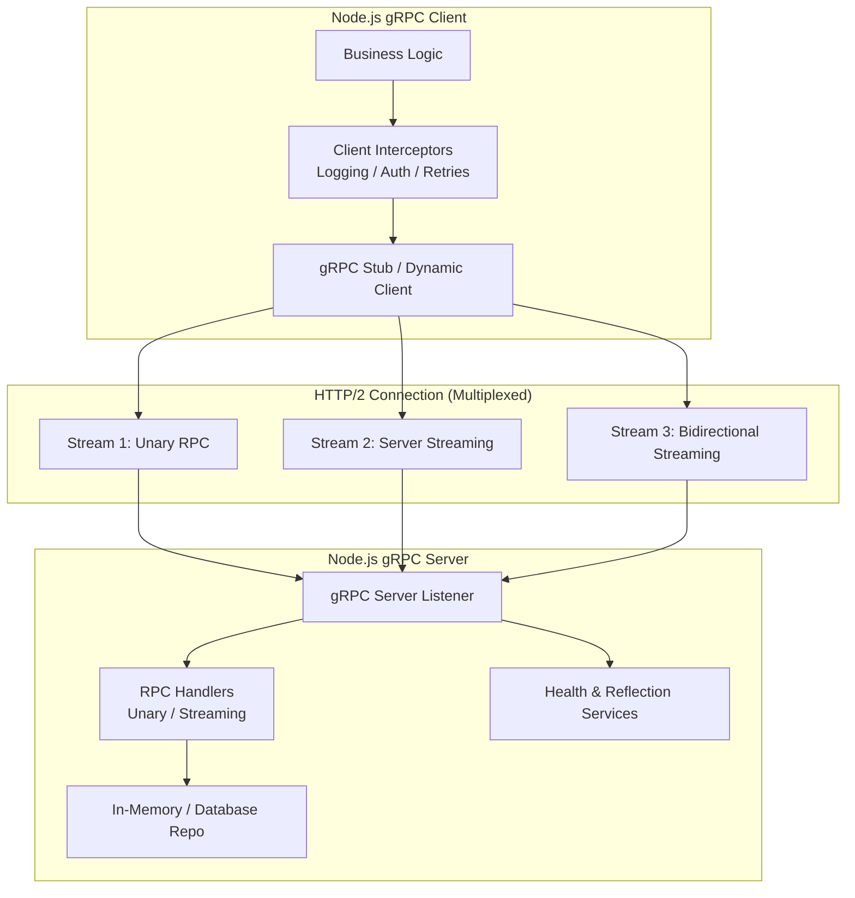
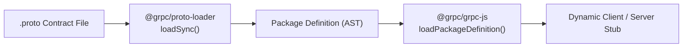
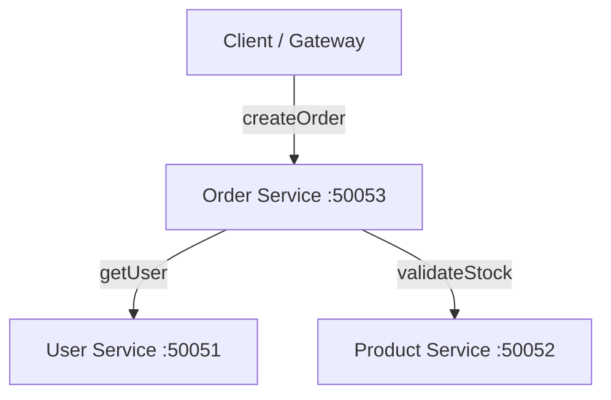

# Architecture Guide: gRPC in Pure Node.js

## 1. High-Level Architecture

gRPC is an open-source, high-performance Remote Procedure Call (RPC) framework developed by Google. In this project, gRPC is implemented in **pure Node.js using JavaScript CommonJS (`require`/`module.exports`)** without any compilation or TypeScript build step.

---

## 2. HTTP/2 Wire Protocol & Multiplexing

Unlike HTTP/1.1 which requires a separate TCP connection or pipelining for parallel requests, gRPC utilizes HTTP/2 over a single persistent TCP connection:

- **Binary Framing**: Protocol Buffers serialize JavaScript objects into compact binary frames rather than ASCII JSON.
- **Streams & Multiplexing**: Thousands of concurrent RPC calls are multiplexed across bidirectional streams on one connection.
- **HTTP Headers & Trailers**:
  - Request headers transmit call metadata (e.g., `authorization`, `x-correlation-id`).
  - Response trailers transmit the final gRPC status code (`grpc-status: 0`) and execution metadata after the response message body is transferred.

---

## 3. Dynamic Protocol Buffer Loading Pipeline

Instead of static code generation that requires external CLI tools (`protoc`), this repository employs dynamic loading:

Options configured in `src/common/proto-loader.js`:
- `keepCase: true`: Preserves snake_case field names from `.proto` definitions.
- `longs: String`: Prevents 64-bit integer precision loss in JavaScript by representing `int64` as strings.
- `enums: String`: Decodes enum wire values into string literals for clarity.
- `defaults: true`: Populates missing proto fields with their type default values.
- `oneofs: true`: Includes active oneof field identifiers on decoded objects.

---

## 4. Microservices Topology (`grpc-commerce-demo`)

- **Separation of Concerns**: Each microservice is an autonomous Node.js process with its own domain logic, port, and health check.
- **Resilience**: The Order Service implements timeouts, client-side retry with backoff, and idempotent deduplication.
