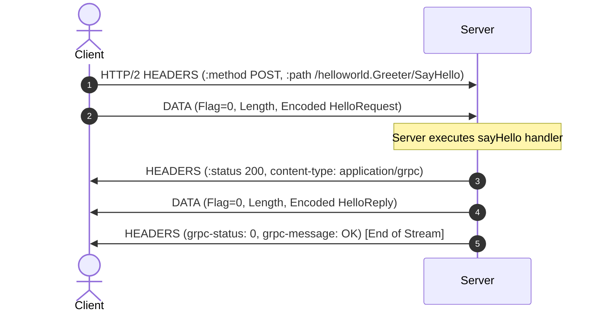

# Lesson 01: gRPC Fundamentals (Hello World)

Welcome to the foundational lesson of gRPC in Node.js and TypeScript. In this lesson, you will build your first working gRPC client and server, examine the Protocol Buffer contract, and learn how gRPC differs from traditional HTTP REST APIs.

---

## 1. The Problem Being Solved

In traditional microservice architectures using REST + JSON over HTTP/1.1:
- Payloads are verbose plain-text JSON strings, incurring CPU overhead in serialization and deserialization (`JSON.stringify`/`JSON.parse`).
- API contracts are loosely enforced via documentation or OpenAPI/Swagger specs that can easily drift out of sync with real server code.
- Network connections cannot multiplex multiple concurrent requests over a single TCP connection without Head-of-Line (HoL) blocking.

gRPC solves this with:
1. **Strict, Contract-First Architecture**: Defined in `.proto` files using Protocol Buffers.
2. **Binary Wire Format**: Highly compact, type-safe serialization.
3. **HTTP/2 Transport**: Native multiplexing, binary framing, header compression (HPACK), and bidirectional streaming.

---

## 2. Core Concepts

### What is Unary RPC?
Unary RPC is the simplest communication pattern in gRPC. It behaves conceptually like a standard function call:
- **Client**: Sends a single request message to the server.
- **Server**: Receives the request, executes business logic, and returns a single response message back along with a status code (`OK` on success).



### Dynamic Loading vs Code Generation
In Node.js, you have two ways to consume `.proto` files:
1. **Dynamic Loading (`@grpc/proto-loader`)**: Parses `.proto` files at runtime. Fast to develop, requires no build steps for protobufs, but requires manual TypeScript interfaces.
2. **Static Generation (`ts-proto` / `protoc-gen-ts`)**: Generates TypeScript classes and interfaces ahead of time. Provides compile-time type safety at the cost of a protoc compiler build step.

In this lesson, we use `@grpc/proto-loader` with TypeScript interfaces to keep the development setup lightweight and portable across all platforms.

---

## 3. Protocol Buffer Definition

File: `proto/helloworld/helloworld.proto`

```protobuf
syntax = "proto3";

package helloworld;

// The greeting service
service Greeter {
  // Sends a greeting. Unary RPC: one request in, one response out.
  rpc SayHello (HelloRequest) returns (HelloReply);
}

// Request message
message HelloRequest {
  string name = 1;
}

// Response message
message HelloReply {
  string message = 1;
}
```

Key points:
- `syntax = "proto3";`: Specifies proto3 syntax rules (default values, no required fields).
- `package helloworld;`: Prevents name collisions across proto definitions.
- Field numbers (`= 1`): Represent the numeric tag encoded on the wire. Field numbers must never change once published!

---

## 4. Implementation Details

### Server (`server.ts`)
```typescript
import * as grpc from '@grpc/grpc-js';
import { ReflectionService } from '@grpc/reflection';
import { loadProtoFile, resolveProtoPath } from '../../src/common/proto-loader';

// 1. Load the proto file
const protoPath = resolveProtoPath('helloworld', 'helloworld.proto');
const { grpcObject, packageDefinition } = loadProtoFile(protoPath);
const helloworldPkg = grpcObject.helloworld as any;

// 2. Instantiate gRPC server
const server = new grpc.Server();

// 3. Register service implementations
server.addService(helloworldPkg.Greeter.service, {
  sayHello: (call, callback) => {
    const name = call.request.name || 'World';
    callback(null, { message: `Hello, ${name}!` });
  },
});

// 4. Register Server Reflection (crucial for grpcurl / Postman inspection)
const reflection = new ReflectionService(packageDefinition);
reflection.addToServer(server);

// 5. Bind port asynchronously
server.bindAsync('0.0.0.0:50051', grpc.ServerCredentials.createInsecure(), (err, port) => {
  if (err) throw err;
  console.log(`Server running on port ${port}`);
});
```

### Client (`client.ts`)
```typescript
import * as grpc from '@grpc/grpc-js';
import { loadProtoFile, resolveProtoPath } from '../../src/common/proto-loader';

const protoPath = resolveProtoPath('helloworld', 'helloworld.proto');
const { grpcObject } = loadProtoFile(protoPath);
const helloworldPkg = grpcObject.helloworld as any;

const client = new helloworldPkg.Greeter('127.0.0.1:50051', grpc.credentials.createInsecure());

client.sayHello({ name: 'Alice' }, (err, response) => {
  if (err) {
    console.error('RPC failed:', err);
    return;
  }
  console.log('Response:', response.message);
  client.close();
});
```

---

## 5. How to Run

### Option A: Using npm scripts (PowerShell / macOS / Linux)

Terminal 1 (Start Server):
```bash
npm run lesson:01:server
```

Terminal 2 (Run Client):
```bash
npm run lesson:01:client
```

Pass a custom name:
```bash
npx tsx lessons/01-grpc-fundamentals/client.ts Bob
```

### Option B: Using grpcurl (CLI Debugging)

Since we registered `@grpc/reflection`, you can inspect and call the server without providing the `.proto` file locally:

```bash
# List available services
grpcurl -plaintext 127.0.0.1:50051 list

# Inspect service definition
grpcurl -plaintext 127.0.0.1:50051 describe helloworld.Greeter

# Invoke SayHello method
grpcurl -plaintext -d '{"name": "Alice"}' 127.0.0.1:50051 helloworld.Greeter/SayHello
```

---

## 6. Expected Output

Server:
```json
{"level":30,"time":1792649201963,"name":"01-helloworld-server","address":"127.0.0.1:50051","msg":"gRPC Hello World server running"}
{"level":30,"time":1792649201995,"name":"01-helloworld-server","name":"Alice","peer":"127.0.0.1:54982","msg":"Received SayHello request"}
```

Client:
```bash
🎉 Server says: Hello, Alice!
```

---

## 7. Common Mistakes & Gotchas

1. **`bindAsync` vs synchronous `bind`**:
   `server.bind()` is deprecated and removed in modern `@grpc/grpc-js`. Always use `server.bindAsync(endpoint, credentials, callback)`.
2. **`SO_REUSEPORT` on Linux/macOS**:
   gRPC sets `SO_REUSEPORT` by default. If a previous node process wasn't stopped properly, starting a new server might bind without error, but requests will be load-balanced between the stale server and the new server! Always verify running processes if you see unexpected responses.
3. **Leaving client connections open**:
   Node.js keeps active event loop timers and sockets open for gRPC channels. If your short-lived client script hangs after receiving the response, make sure you call `client.close()` or call `process.exit()`.
4. **Proto-loader property casing**:
   Without `keepCase: true`, fields named `user_id` are converted to `userId`. In our standard loader, we enable `keepCase: true` so the JavaScript keys match the protobuf contract exactly.

---

## 8. Exercises

1. **Add a new RPC**: Open `proto/helloworld/helloworld.proto` and add an RPC `SayGoodbye (HelloRequest) returns (HelloReply)`. Implement it in `server.ts` and call it from `client.ts`.
2. **Add error condition**: In `server.ts`, if `name === 'Voldemort'`, return an `INVALID_ARGUMENT` gRPC error instead of a greeting using `createGrpcError(grpc.status.INVALID_ARGUMENT, 'Name forbidden')`. Observe how the client receives it.

---

## 9. Interview Questions with Answers

### Q1: Why does gRPC use HTTP/2 instead of HTTP/1.1?
**Answer**:
HTTP/2 provides binary framing, multiplexing multiple concurrent streams over a single TCP connection without Head-of-Line blocking, header compression (HPACK), and native support for bidirectional streaming. In contrast, HTTP/1.1 requires opening separate TCP connections for concurrent requests or experiences pipelining blocking.

### Q2: What is the purpose of field numbers in Protocol Buffers?
**Answer**:
Protocol Buffers do not transmit field names across the wire. Instead, field numbers (tags) are packed into varints along with wire type information. This minimizes wire payload size. Because field numbers identify fields on the wire, changing a field number breaks backward and forward compatibility.

### Q3: What is gRPC Server Reflection and why should it be enabled?
**Answer**:
gRPC Server Reflection is an extension service that allows clients, CLI tools (like `grpcurl`), and API testing suites (like Postman or Insomnia) to query the server at runtime for its schema and service definitions. It eliminates the need to distribute `.proto` files to developers testing internal services.
