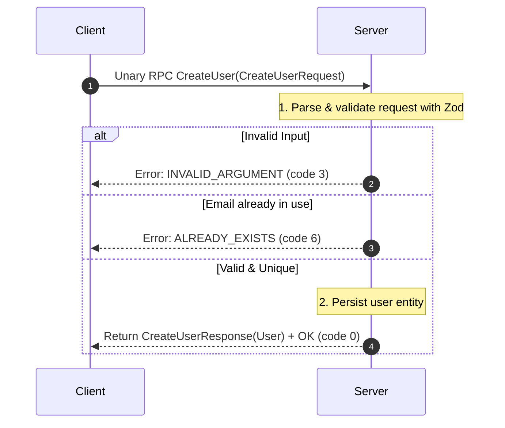

# Lesson 03: Unary RPC (UserService)

In this lesson, you will master the most common gRPC pattern: **Unary RPC**. You will build a production-grade `UserService` featuring schema validation, standard error handling, pagination, and clean architecture separating business logic from transport protocols.

---

## 1. The Problem Being Solved

In naive gRPC implementations:
- Handlers directly manipulate global state or perform raw queries, making the code untestable.
- Errors are returned as unhandled JavaScript exceptions, which causes gRPC to return a generic `UNKNOWN` code (code 2) with cryptic stack traces.
- Validation is either omitted or haphazardly implemented with ad-hoc `if` statements.
- Listing queries return unbounded arrays, leading to memory exhaustion and buffer overflows on large datasets.

We solve these issues by:
1. **Repository Pattern**: Business logic and storage reside in `src/services/user-repository.ts`. Handlers only orchestrate gRPC calls.
2. **Schema Validation with Zod**: Every request payload is strictly validated before touching business logic.
3. **Structured Status Codes**: We return canonical gRPC status codes (`INVALID_ARGUMENT`, `NOT_FOUND`, `ALREADY_EXISTS`).
4. **Token-Based Pagination**: Safe, bounded queries using standard `PageRequest` and `PageResponse`.

---

## 2. Request-Response Lifecycle



---

## 3. Protocol Buffer Definition

File: `proto/users/v1/users.proto`

```protobuf
syntax = "proto3";

package users.v1;

import "common/v1/common.proto";
import "google/protobuf/timestamp.proto";

service UserService {
  rpc GetUser (GetUserRequest) returns (GetUserResponse);
  rpc CreateUser (CreateUserRequest) returns (CreateUserResponse);
  rpc ListUsers (ListUsersRequest) returns (ListUsersResponse);
}
```

---

## 4. How to Run

Terminal 1 (Start Server):
```bash
npm run lesson:03:server
```

Terminal 2 (Run Client):
```bash
npm run lesson:03:client
```

---

## 5. Expected Output

```
--- 1. Testing CreateUser ---
✅ Created user: Charlie Bucket (usr_abc123)

--- 2. Testing GetUser ---
✅ Retrieved user: charlie_1792649377968@example.com (Status: USER_STATUS_ACTIVE)

--- 3. Testing GetUser (Negative: NOT_FOUND) ---
✅ Expected error caught: [NOT_FOUND] User with ID non_existent_id not found

--- 4. Testing ListUsers (Pagination) ---
✅ ListUsers returned 2 users (Total: 3)
   Next Page Token: "Mg=="
```

---

## 6. Common Mistakes

1. **Throwing JavaScript Errors**:
   Throwing an exception inside an async or callback handler will often bypass the callback and either crash the process or yield `UNKNOWN (code 2)`. Always invoke `callback(createGrpcError(status, message))`.
2. **Confusing HTTP status codes with gRPC status codes**:
   - HTTP 400 != gRPC 400. In gRPC, bad input is `grpc.status.INVALID_ARGUMENT (code 3)`.
   - HTTP 404 is `grpc.status.NOT_FOUND (code 5)`.
   - HTTP 409 is `grpc.status.ALREADY_EXISTS (code 6)`.
   - HTTP 401/403 are `UNAUTHENTICATED (code 16)` and `PERMISSION_DENIED (code 7)`.
3. **Offset vs Cursor Pagination**:
   Using numeric offsets (`LIMIT/OFFSET`) in high-concurrency databases causes pagination drift (missed or duplicate rows if rows are inserted while paginating). In production, prefer cursor-based tokens based on indexed timestamps or IDs.

---

## 7. Exercises

1. **Implement `UpdateUser` RPC**: Add an `UpdateUser` method to `proto/users/v1/users.proto`. Validate with Zod that name is non-empty, and update the entity in `UserRepository`.
2. **Implement Soft Delete**: Add a `DeleteUser` method that sets status to `USER_STATUS_INACTIVE` or `USER_STATUS_SUSPENDED`.

---

## 8. Interview Questions with Answers

### Q1: What happens if a gRPC server handler does not call `callback()`?
**Answer**:
The client's HTTP/2 stream remains open indefinitely until either the client's deadline/timeout expires or the underlying TCP connection times out. This can lead to connection exhaustion and memory leaks. Always ensure every code branch in a handler executes the callback or stream end.

### Q2: How should errors be structured in production gRPC services?
**Answer**:
Internal stack traces and database errors must never be returned to clients directly. Instead, map internal errors to a safe, public gRPC status code and human-readable message. For rich structured errors (like multiple validation field failures), attach `google.rpc.Status` with `BadRequest.FieldViolation` details into the gRPC error metadata.
