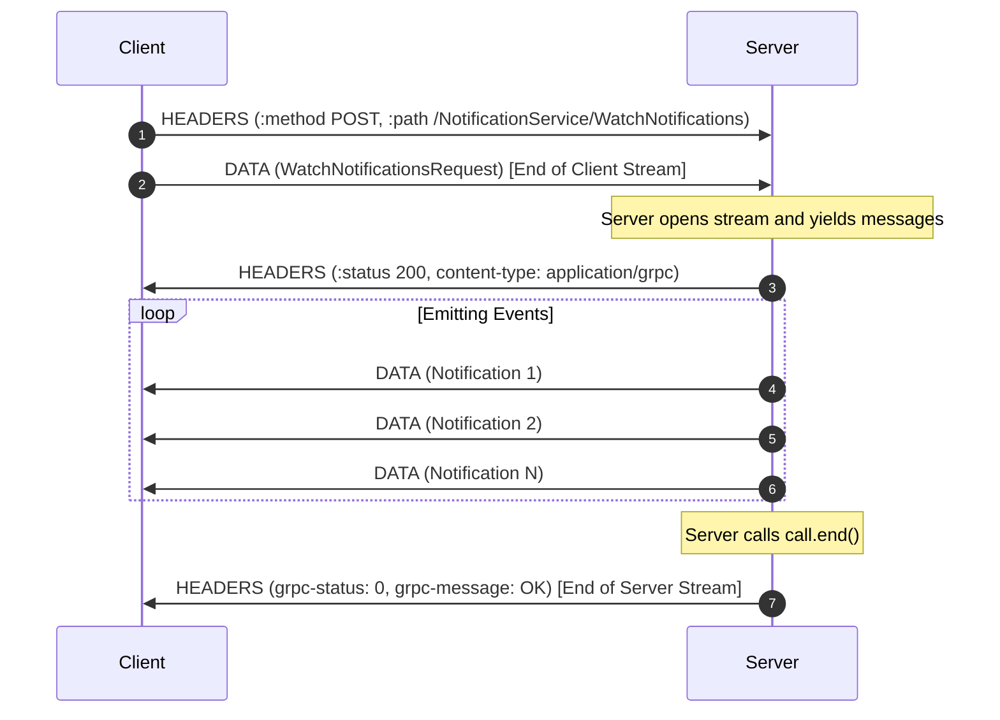

# Lesson 04: Server Streaming (WatchNotifications)

In this lesson, you will master **Server Streaming RPCs**. You will learn how a client issues a single initial request to receive a continuous sequence of response messages over time.

---

## 1. The Problem Being Solved

Consider real-time feeds: notifications, telemetry data, financial tick streams, or LLM token streaming.
In REST:
- Polling (`setInterval(() => fetch(...), 1000)`): Creates massive HTTP overhead, header repetition, high latency, and wasted server CPU.
- WebSockets: Separate protocol outside the standard HTTP API stack; lacks strict protobuf schemas and type generation.
- Server-Sent Events (SSE): HTTP/1.1 or HTTP/2 text stream, but one-way and text-only.

In gRPC Server Streaming:
- Uses the existing HTTP/2 TCP connection.
- Compact binary protobuf encoding.
- Structured backpressure: the server pauses writing if the client's network buffer is saturated.
- Built-in cancellation propagation.

---

## 2. Request-Response Lifecycle



---

## 3. Implementation Details

### Server (`server.ts`)
The server handler receives a `grpc.ServerWritableStream`:
```typescript
function watchNotifications(call: grpc.ServerWritableStream<any, any>): void {
  const { user_id } = call.request;

  // 1. Listen for client cancellation
  call.on('cancelled', () => {
    console.log('Client aborted stream');
    clearInterval(timer);
  });

  // 2. Write data frames
  const timer = setInterval(() => {
    const canContinue = call.write({ id: '1', title: 'New Alert' });

    // 3. Backpressure check
    if (!canContinue) {
      call.once('drain', () => console.log('Buffer drained'));
    }
  }, 1000);

  // 4. Terminate stream when done
  // call.end();
}
```

### Client (`client.ts`)
The client receives a Node.js `ReadableStream`:
```typescript
const stream = client.watchNotifications({ user_id: 'usr_123' });

stream.on('data', (notification) => {
  console.log('Received:', notification.title);
});

stream.on('end', () => {
  console.log('Server completed stream');
});

stream.on('error', (err) => {
  if (err.code === grpc.status.CANCELLED) {
    console.log('Cancelled cleanly');
  }
});

// To abort from client side at any time:
// stream.cancel();
```

---

## 4. How to Run

Terminal 1 (Start Server):
```bash
npm run lesson:04:server
```

Terminal 2 (Run Client):
```bash
npm run lesson:04:client
```

---

## 5. Expected Output

Client:
```
🔔 [NOTIFICATION_TYPE_INFO] System Alert #1: Notification payload #1 dispatched for user user_demo_42
🔔 [NOTIFICATION_TYPE_WARNING] System Alert #2: Notification payload #2 dispatched for user user_demo_42
🔔 [NOTIFICATION_TYPE_INFO] System Alert #3: Notification payload #3 dispatched for user user_demo_42
🔔 [NOTIFICATION_TYPE_WARNING] System Alert #4: Notification payload #4 dispatched for user user_demo_42
🔔 [NOTIFICATION_TYPE_INFO] System Alert #5: Notification payload #5 dispatched for user user_demo_42

✅ Stream finished. Total events received: 5
```

---

## 6. Common Mistakes

1. **Ignoring Backpressure**:
   Calling `call.write()` inside an unconstrained loop without checking its return boolean can exhaust server RAM if the client is slow to read or network latency spikes.
2. **Forgetting to check `call.cancelled`**:
   If a client drops connection, an unmanaged interval or loop will keep producing events into a closed socket, causing `ERR_STREAM_WRITE_AFTER_END` or memory leaks. Always register `call.on('cancelled')`.
3. **Failing to call `call.end()`**:
   If the server finishes producing data but does not call `call.end()`, the client hangs indefinitely waiting for more events.

---

## 7. Exercises

1. **Add Filtering**: Modify `server.ts` to inspect `request.types`. If `types` contains specific enums (e.g., `NOTIFICATION_TYPE_ERROR`), only send matching notifications.
2. **Simulate Slow Consumer**: In `client.ts`, add a deliberate `await new Promise(r => setTimeout(r, 500))` inside the data handler and observe the server's backpressure log.

---

## 8. Interview Questions with Answers

### Q1: What happens under the hood when a gRPC client cancels a server stream?
**Answer**:
The client's HTTP/2 stack sends an `RST_STREAM` frame with error code `CANCEL` (`0x8`) to the server. The server's HTTP/2 session receives this frame, emits the `'cancelled'` event on the server call stream, sets `call.cancelled = true`, and returns status `CANCELLED (code 1)`.

### Q2: How does backpressure work in gRPC Node.js server streaming?
**Answer**:
In Node.js, `ServerWritableStream` inherits from `stream.Writable`. When `call.write(chunk)` returns `false`, the underlying HTTP/2 stream queue has exceeded its high water mark buffer limit. The server should stop pushing messages and wait for the `'drain'` event before resuming writes.
