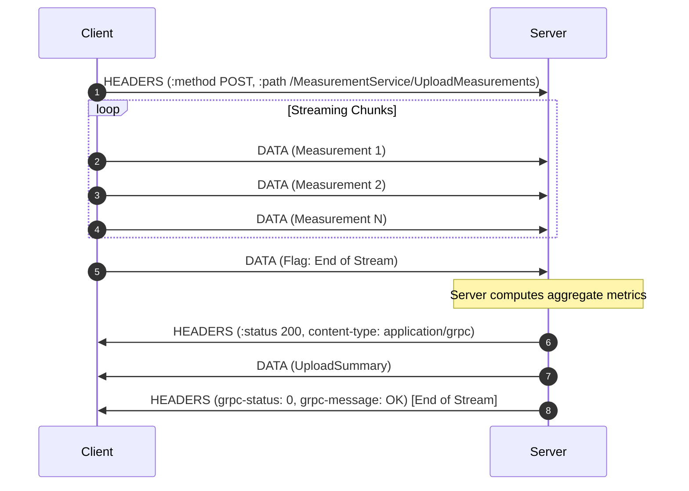

# Lesson 05: Client Streaming (UploadMeasurements)

In this lesson, you will master **Client Streaming RPCs**. You will learn how a client can send a sequence of messages over an HTTP/2 stream, and how the server processes the data incrementally before returning a single summary response upon completion.

---

## 1. The Problem Being Solved

Consider scenarios where a client produces large or continuous chunks of data:
- Uploading large IoT sensor telemetry or time-series metrics.
- Uploading large files in chunks (avoiding buffering a 1 GB file entirely in Node.js heap memory).
- Batch ingestion of records where the client sends thousands of items.

In REST:
- In HTTP/1.1 POST, sending a giant payload in a single request risks payload size limits (e.g. 413 Payload Too Large) or timeouts.
- Sending one HTTP request per measurement causes thousands of TCP handshakes and header overhead.

In gRPC Client Streaming:
- Uses a single persistent HTTP/2 connection.
- Memory efficient: the server processes items incrementally as they arrive without loading everything into memory.
- Concurrency: server begins parsing and verifying chunk 1 while chunk 10 is still in transit over the network.

---

## 2. Request-Response Lifecycle



---

## 3. Implementation Details

### Server (`server.ts`)
The server handler receives a `ServerReadableStream` and a unary callback:
```typescript
function uploadMeasurements(
  call: grpc.ServerReadableStream<Measurement, UploadSummary>,
  callback: grpc.sendUnaryData<UploadSummary>,
): void {
  let count = 0;
  let sum = 0;

  // 1. Process each incoming chunk incrementally
  call.on('data', (measurement: Measurement) => {
    count++;
    sum += measurement.value;
  });

  // 2. Return summary when client closes stream
  call.on('end', () => {
    callback(null, {
      total_received: count,
      average_value: count > 0 ? sum / count : 0,
      // ...
    });
  });

  // 3. Handle early abortion
  call.on('cancelled', () => {
    console.warn('Client aborted upload');
  });
}
```

### Client (`client.ts`)
In Node.js, `client.uploadMeasurements(callback)` returns a standard `stream.Writable`:
```typescript
const stream = client.uploadMeasurements((err, summary) => {
  if (err) throw err;
  console.log('Aggregated summary:', summary);
});

// Stream data items
stream.write({ sensor_id: 'sensor-1', value: 24.2 });
stream.write({ sensor_id: 'sensor-1', value: 25.1 });

// Signal end of stream
stream.end();
```

---

## 4. How to Run

Terminal 1 (Start Server):
```bash
npm run lesson:05:server
```

Terminal 2 (Run Client):
```bash
npm run lesson:05:client
```

---

## 5. Expected Output

```
📊 Sensor Upload Summary:
- Total Received: 5
- Accepted:       3
- Rejected:       2
- Average Value:  22
- Min Value:      20
- Max Value:      24.5
```

---

## 6. Common Mistakes

1. **Forgetting `stream.end()` on the Client**:
   If the client writes all items but forgets to call `stream.end()`, the server continues waiting forever, and the callback will never execute.
2. **Buffering all items in memory on the server**:
   The primary benefit of client streaming is avoiding heap exhaustion. If your server pushes every item into an array (`const items = []; items.push(chunk)`), you lose the memory efficiency benefit! Process items as a stream.
3. **Premature Callback invocation**:
   Calling `callback(null, summary)` before `call.on('end')` fires will terminate the stream while the client is still writing, causing `ERR_STREAM_WRITE_AFTER_END` on the client.

---

## 7. Exercises

1. **Add Rate Limiting**: In `server.ts`, track the rate of incoming messages per `sensor_id`. If a sensor sends more than 50 messages/sec, reject additional items.
2. **File Chunk Upload**: Implement a script that reads a local file chunk-by-chunk using `fs.createReadStream()` and pipes it into the client gRPC upload stream.

---

## 8. Interview Questions with Answers

### Q1: How does client streaming handle network failures mid-stream?
**Answer**:
If the network connection drops while the client is streaming chunks, HTTP/2 detects the lost connection (via TCP timeout or GOAWAY/RST_STREAM). In Node.js, the client stream emits an `'error'` event with status `UNAVAILABLE (code 14)`. Because gRPC streams are stateful, any partially received data on the server must either be discarded or stored in a transactional staging table with a resumable session ID.

### Q2: Why is client streaming superior to REST multipart/form-data for sensor data?
**Answer**:
Multipart form uploads require boundary delineation headers, base64 or text encoding overhead, and usually force the web server or reverse proxy to buffer the complete request body before passing it to the application worker. gRPC client streaming sends raw binary protobuf frames that the server deserializes incrementally in streaming fashion, drastically reducing memory footprint and processing latency.
