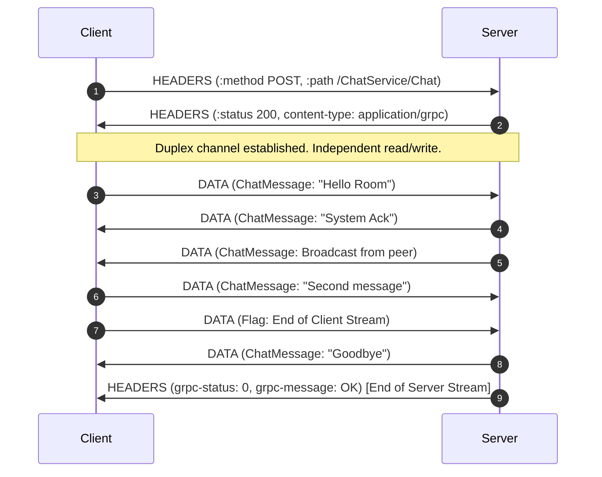

# Lesson 06: Bidirectional Streaming (ChatService)

In this lesson, you will master the most flexible and powerful gRPC communication pattern: **Bidirectional Streaming RPCs**. You will learn how both client and server communicate asynchronously and concurrently over a single HTTP/2 connection.

---

## 1. The Problem Being Solved

Real-time interactive applications require concurrent two-way communication:
- Multi-user chat applications.
- Real-time multiplayer gaming state synchronization.
- Interactive AI voice/text agents (e.g. streaming audio chunks in while streaming synthesized response audio out).
- Live financial market arbitrage bots.

In REST:
- Not supported. Long-polling and Server-Sent Events (SSE) are unidirectional.
- WebSockets: Full-duplex, but lacks built-in message typing, schema evolution, standard error semantics, multiplexing across services, and HTTP/2 header compression.

In gRPC Bidirectional Streaming:
- Full duplex: both sides send and receive data frames independently.
- Independent lifecycles: the client can keep sending while the server sends responses, or the client can finish its writes while continuing to listen to incoming server events.
- Structured protobuf messages on both channels.

---

## 2. Request-Response Lifecycle



---

## 3. Implementation Details

### Server (`server.ts`)
The server handler receives a `ServerDuplexStream`:
```typescript
function chat(call: grpc.ServerDuplexStream<ChatMessage, ChatMessage>): void {
  // 1. Listen for messages sent by the client
  call.on('data', (msg) => {
    // Send immediate response or broadcast to other active streams
    call.write({ sender: 'SystemBot', text: `Ack: "${msg.text}"` });
  });

  // 2. Client closed their send channel
  call.on('end', () => {
    // Server can conclude or keep sending before calling call.end()
    call.end();
  });

  // 3. Client disconnected abruptly
  call.on('cancelled', () => {
    console.warn('Client cancelled duplex stream');
  });
}
```

### Client (`client.ts`)
Calling `client.chat()` returns a Node.js `stream.Duplex`:
```typescript
const stream = client.chat();

// Handle incoming messages
stream.on('data', (msg) => {
  console.log(`[${msg.sender}]: ${msg.text}`);
});

// Send outgoing messages
stream.write({ sender: 'Alice', text: 'Hello!' });

// End client write half when finished
stream.end();
```

---

## 4. How to Run

Terminal 1 (Start Server):
```bash
npm run lesson:06:server
```

Terminal 2 (Run Client):
```bash
npm run lesson:06:client
```

---

## 5. Expected Output

```
📤 [Alice] Sending: "Hi everyone!"
📤 [Alice] Sending: "Is anyone exploring gRPC today?"
💬 [Room: #general] SystemBot: Ack: "Hi everyone!" delivered to room #general
💬 [Room: #general] SystemBot: Ack: "Is anyone exploring gRPC today?" delivered to room #general

🏁 Chat session completed. Total messages received: 2
```

---

## 6. Common Mistakes

1. **Assuming lockstep request/response**:
   Bidirectional streaming is NOT ping-pong. The server does not need to wait for a client message to send data, and the client does not need to wait for a server response to send another message. They are two independent streams bound to the same HTTP/2 call.
2. **Memory Leaks from Stale Stream References**:
   When storing active client streams in a chat room `Set` or `Map`, always remove disconnected streams in `call.on('end')`, `call.on('cancelled')`, and `call.on('error')`. Otherwise, closed streams accumulate and cause memory leaks.
3. **Missing Error Listeners on Duplex Streams**:
   In Node.js, if a TCP connection drops or is reset, any `Duplex` stream without an attached `'error'` listener will throw an unhandled exception that crashes the Node process. Always register `stream.on('error', handler)`.

---

## 7. Exercises

1. **Typing Indicators**: Add a `is_typing` boolean field to `chat.proto`. When a client sends a typing status update, broadcast it to other room participants.
2. **Private Direct Messages**: Modify the server to route messages to a specific user if a `recipient` field is specified, rather than broadcasting to the entire room.

---

## 8. Interview Questions with Answers

### Q1: How does gRPC bidirectional streaming differ from WebSockets?
**Answer**:
- **Protocol**: WebSockets upgrade from HTTP/1.1 to a standalone TCP-based framing protocol on port 80/443. gRPC bidirectional streaming uses standard HTTP/2 bidirectional DATA frames without a protocol upgrade.
- **Multiplexing**: A WebSocket connection carries a single logical stream. gRPC multiplexes multiple RPC calls (unary, server streaming, bidi streaming) concurrently over a single TCP connection.
- **Contract & Serialization**: WebSockets have no default serialization or schema (usually arbitrary JSON text or raw ArrayBuffers). gRPC uses strict Protocol Buffer binary schemas with type safety.

### Q2: What is half-closed stream state in HTTP/2 and gRPC?
**Answer**:
When a client calls `stream.end()`, it sends an HTTP/2 frame with the `END_STREAM` flag set. The client stream is now "half-closed (local)". The client can no longer send DATA frames, but its read side remains open. The server can continue streaming responses back until it too calls `call.end()`, fully closing the stream.
