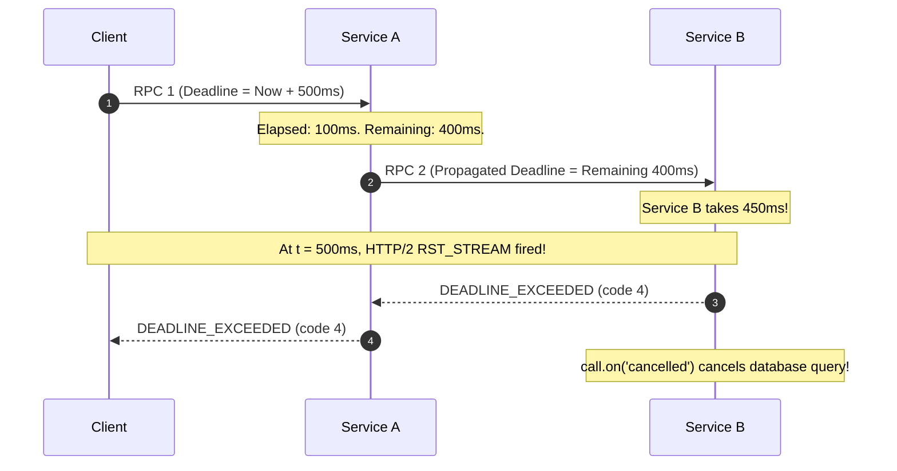

# Lesson 07: Deadlines and Timeouts

In this lesson, you will learn how gRPC manages request execution windows using **Deadlines** rather than simple client timeouts, how deadlines are propagated through microservice call chains, and how to stop wasteful downstream processing when a client disconnects.

---

## 1. The Problem Being Solved

In traditional HTTP/1.1 REST architectures, developers often configure a client timeout:
"Wait 5 seconds for a response from Service A."
If Service A calls Service B, and Service B calls Service C:
- Service A might have a 5-second timeout, but Service B has a 10-second timeout.
- If Service B takes 7 seconds, Service A has already returned HTTP 504 to the user.
- Yet Service B and Service C continue churning CPU and database transactions for a request that the user has already abandoned! This is known as **cascading resource waste**.

gRPC solves this with **Absolute Deadlines**:
- A deadline is a specific point in time (e.g. `2026-10-22T06:30:00.000Z`).
- The deadline travels in the HTTP/2 `grpc-timeout` header across every microservice hop.
- If Service B receives the request 2 seconds later, it knows it only has 3 seconds remaining, not 10.
- If the deadline expires, the entire call chain aborts immediately with `DEADLINE_EXCEEDED (code 4)`.

---

## 2. Request Lifecycle & Propagation



---

## 3. Implementation Details

### Client Deadline Configuration
In Node.js `@grpc/grpc-js`, pass the deadline as a `Date` or epoch millisecond number in the call options:
```typescript
const timeoutMs = 2000;
const deadline = new Date(Date.now() + timeoutMs);

client.sayHello({ name: 'Alice' }, { deadline }, (err, response) => {
  if (err?.code === grpc.status.DEADLINE_EXCEEDED) {
    console.error('Request timed out!');
    return;
  }
  console.log('Success:', response.message);
});
```

### Server Deadline Inspection & Cancellation
```typescript
function sayHello(call, callback) {
  const deadline = call.getDeadline(); // Returns Date or epoch ms
  const remainingMs = typeof deadline === 'number' ? deadline - Date.now() : Infinity;

  const timer = setTimeout(() => {
    callback(null, { message: 'Done' });
  }, 5000);

  // CRITICAL: Stop background work if deadline passes or client cancels
  call.on('cancelled', () => {
    clearTimeout(timer);
    console.log('Work aborted due to deadline or cancellation');
  });
}
```

---

## 4. How to Run

```bash
npx tsx lessons/07-deadlines-and-timeouts/client.ts
```

---

## 5. Expected Output

```
--- 1. Testing call with sufficient deadline (1000ms) ---
✅ Succeeded: Hello after 300ms, DeadlineUser_1000ms!

--- 2. Testing call with tight deadline (50ms) ---
✅ Caught expected timeout: [DEADLINE_EXCEEDED] Deadline exceeded after 0.063s
```

---

## 6. Common Mistakes

1. **Not setting a deadline on the client**:
   By default, gRPC clients have **NO DEADLINE** (infinite timeout). If the server hangs or a network partition occurs, the client connection hangs forever, consuming thread/event loop handles. **Every production RPC must have an explicit deadline.**
2. **Ignoring `call.cancelled` on the server**:
   When a deadline expires, gRPC stops waiting for the server callback, but the server handler function continues running in the background unless your code explicitly checks `call.cancelled` or registers `call.on('cancelled')`.
3. **Resetting timeouts downstream**:
   When Service A receives a request with 200ms remaining, never create a fresh `new Date(Date.now() + 5000)` deadline when calling Service B. Always forward `call.getDeadline()`.

---

## 7. Exercises

1. **Propagate Deadline**: Implement a proxy server that receives an incoming RPC and calls an upstream server using `options: { deadline: call.getDeadline() }`.
2. **AbortController Integration**: Connect `call.on('cancelled')` to a Node.js standard `AbortController` to cancel an upstream `fetch()` or database query.

---

## 8. Interview Questions with Answers

### Q1: What is the difference between a timeout and a deadline?
**Answer**:
A timeout is a relative duration ("wait 3 seconds"). A deadline is an absolute point in time ("complete by 12:00:03.500 UTC"). Using absolute deadlines allows multiple distributed services in a call tree to share the same expiration target without clock drift or cumulative duration inflation.

### Q2: How is the deadline transmitted across the wire in gRPC?
**Answer**:
The client calculates the remaining duration and formats it into the `grpc-timeout` HTTP/2 header using an integer value and a unit specifier (e.g. `500m` for 500 milliseconds, `2S` for 2 seconds, `10M` for 10 minutes). The receiving server parses this header and reconstructs the deadline timestamp relative to its local clock.
