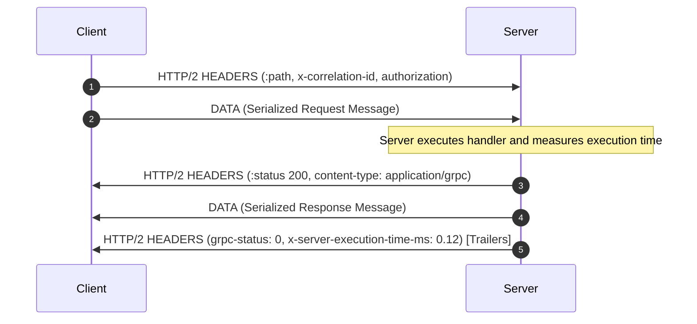

# Lesson 09: Metadata and Interceptors

In this lesson, you will master **Metadata** (`grpc.Metadata`) and **Interceptors** (middleware) in gRPC. You will learn how cross-cutting concerns—such as distributed tracing correlation IDs, latency measurement, authentication headers, and audit logs—are implemented cleanly outside business logic handlers.

---

## 1. The Problem Being Solved

In distributed microservices:
- Requests pass through multiple services (API Gateway -> Order Service -> Inventory Service -> Payment Service).
- Without a unified tracing identifier, correlating logs across 10 distributed services during an outage is impossible.
- Polluting method signatures by adding `correlationId`, `authToken`, or `clientVersion` parameters to every protobuf message violates separation of concerns.

gRPC solves this with:
1. **Metadata**: Key-value pairs sent as HTTP/2 HEADERS (initial metadata) and trailers (trailing metadata sent after the response body with the final status code).
2. **Interceptors**: Pre- and post-processing filters that wrap gRPC client calls and server handlers, equivalent to Express or Koa middleware.

---

## 2. Request Metadata vs Trailing Metadata (Trailers)



- **Headers (Initial Metadata)**: Sent before the response payload. Used for authentication, content negotiation, tracing IDs.
- **Trailers (Trailing Metadata)**: Sent alongside the status code *after* the payload. Used for latency reporting, server processing statistics, and error violation details.

---

## 3. Implementing a Client Interceptor

A client interceptor wraps `nextCall`:

```typescript
export function clientLoggingInterceptor(options, nextCall) {
  return new grpc.InterceptingCall(nextCall(options), {
    start: (metadata, listener, next) => {
      // 1. Inject correlation ID into request metadata
      const correlationId = metadata.get('x-correlation-id')[0] || generateUuid();
      metadata.set('x-correlation-id', correlationId);

      const startTime = performance.now();

      // 2. Intercept response status & trailers
      const interceptedListener = {
        onReceiveStatus: (status, nextStatus) => {
          const duration = (performance.now() - startTime).toFixed(2);
          console.log(`RPC ${options.method_definition.path} finished in ${duration}ms with status ${status.code}`);
          nextStatus(status);
        },
      };

      next(metadata, interceptedListener);
    },
  });
}
```

Configuring on the client:
```typescript
const client = new GreeterClient('127.0.0.1:50051', grpc.credentials.createInsecure(), {
  interceptors: [clientLoggingInterceptor],
});
```

---

## 4. How to Run

```bash
npx tsx lessons/09-metadata-and-interceptors/client.ts
```

---

## 5. Expected Output

```
🎉 Server Response: Hello, InterceptorUser!
📦 Returned Trailers: {
  'x-server-execution-time-ms': '0.12',
  'x-correlation-id': 'custom-corr-1792650950130'
}
```

---

## 6. Common Mistakes

1. **ASCII vs Binary Metadata Keys**:
   Keys ending in `-bin` (e.g. `auth-token-bin`) tell gRPC to automatically Base64 encode/decode raw binary Buffer values across the wire. Non-bin keys must only contain ASCII printable characters (lowercase `a-z`, `0-9`, `-`, `_`, `.`).
2. **Metadata Key Lowercasing**:
   HTTP/2 header names are strictly lowercase. Accessing `metadata.get('X-Correlation-ID')` will be normalized to lowercase by gRPC; always use lowercase keys.
3. **Closing client before trailers are processed**:
   If a client closes immediately inside the unary callback without waiting for the `'status'` event, response trailers might be discarded before read handlers fire.

---

## 7. Exercises

1. **Server-Side Interceptor Wrapper**: Write a server-side helper function `withLogging(handler)` that automatically extracts `x-correlation-id` and logs request latency for any unary handler.
2. **Binary Metadata**: Send a binary HMAC signature using `metadata.set('hmac-signature-bin', Buffer.from([1, 2, 3, 4]))` and inspect it on the server.

---

## 8. Interview Questions with Answers

### Q1: What are HTTP/2 trailers in gRPC and why are they important?
**Answer**:
HTTP/2 trailers are headers transmitted *after* all DATA frames. In gRPC, the status code (`grpc-status`) and status message (`grpc-message`) are always sent in the trailing metadata. This architectural design allows the server to stream data chunks and only determine whether the operation ultimately succeeded or failed at the very end of the stream without having to buffer the entire response upfront.

### Q2: What kinds of logic belong in gRPC interceptors vs business handlers?
**Answer**:
Interceptors should contain cross-cutting, transport-level concerns: authentication verification, request deadline enforcement, structured logging, distributed tracing (OpenTelemetry / correlation IDs), rate limiting, and client retry logic. Business validation, domain rules, and database operations should remain inside the service layer.
