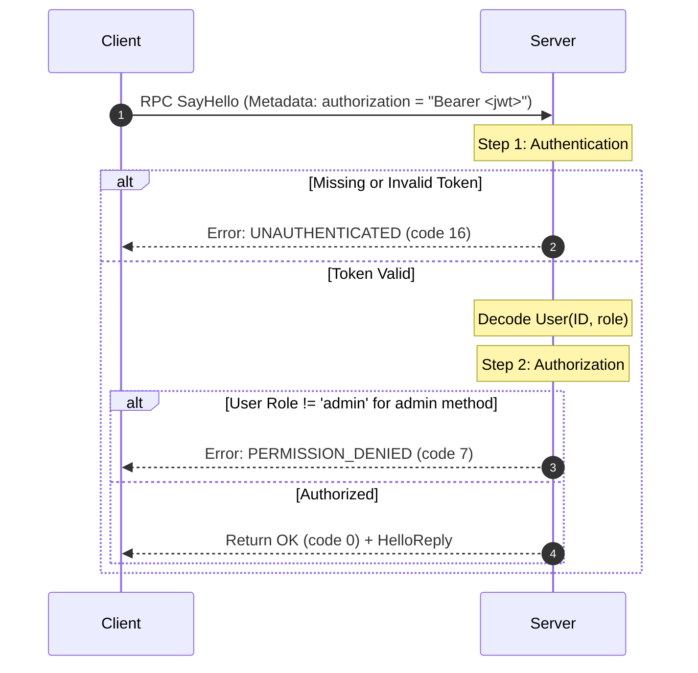

# Lesson 10: Authentication and Authorization

In this lesson, you will learn how to implement security in gRPC: issuing and verifying JSON Web Tokens (JWT), extracting Bearer tokens from gRPC Metadata, enforcing Role-Based Access Control (RBAC), and distinguishing between `UNAUTHENTICATED (16)` and `PERMISSION_DENIED (7)`.

---

## 1. The Problem Being Solved

In HTTP REST APIs, authentication is traditionally passed via the HTTP `Authorization: Bearer <token>` header.
In gRPC:
- Binary protobuf messages must remain clean and agnostic to session or transport tokens.
- Authentication tokens belong in the HTTP/2 metadata layer (`grpc.Metadata`).
- Authorizing calls early prevents unauthorized users from executing expensive database operations or violating multi-tenant boundaries.

---

## 2. Authentication vs Authorization Flow



---

## 3. Implementation Details

### Attaching Token on Client
```typescript
import * as grpc from '@grpc/grpc-js';

const metadata = new grpc.Metadata();
metadata.set('authorization', `Bearer ${jwtToken}`);

client.sayHello({ name: 'Alice' }, metadata, (err, response) => {
  // ...
});
```

### Verifying on Server
```typescript
function verifyAuthMetadata(metadata: grpc.Metadata): AuthUser {
  const authHeader = metadata.get('authorization')[0]?.toString();
  if (!authHeader) {
    throw createGrpcError(grpc.status.UNAUTHENTICATED, 'Missing Authorization header');
  }

  const [scheme, token] = authHeader.split(' ');
  if (scheme !== 'Bearer' || !token) {
    throw createGrpcError(grpc.status.UNAUTHENTICATED, 'Malformed Authorization header');
  }

  return jwt.verify(token, JWT_SECRET) as AuthUser;
}
```

---

## 4. How to Run

```bash
npx tsx lessons/10-authentication-and-authorization/client.ts
```

---

## 5. Expected Output

```
--- 1. Testing Unauthenticated Request (No Token) ---
✅ Caught expected error: [UNAUTHENTICATED] Missing Authorization metadata header

--- 2. Testing Regular User Token for Standard Request ---
✅ Succeeded: Hello user@example.com! (Role: user, UserID: usr_reg_1)

--- 3. Testing Regular User Token for Admin-Only Action ---
✅ Caught expected error: [PERMISSION_DENIED] Insufficient permissions: admin role required

--- 4. Testing Admin User Token for Admin-Only Action ---
✅ Succeeded: Hello root@test.com! (Role: admin, UserID: usr_adm_99)
```

---

## 6. Common Mistakes

1. **Hardcoding JWT Secrets in Code**:
   Always load JWT secrets and private keys from validated environment variables (`process.env.JWT_SECRET`), never hardcode production keys in repository source.
2. **Confusing 401 with 403**:
   - `UNAUTHENTICATED (code 16)` = Who are you? (Credentials missing or invalid).
   - `PERMISSION_DENIED (code 7)` = I know who you are, but you do not have permission to do this.
3. **Placing auth tokens inside protobuf message fields**:
   Do not add `string auth_token = 99;` to every message definition. Use `grpc.Metadata`.

---

## 7. Exercises

1. **Token Expiry**: Create an expired JWT token (`expiresIn: '-1s'`) and verify that `jwt.verify()` causes the server to return `UNAUTHENTICATED`.
2. **Per-RPC Credentials (CallCredentials)**: Use `grpc.credentials.combineChannelCredentials` with `grpc.credentials.createFromMetadataGenerator` to automatically attach the token to every call on the client stub without manually passing metadata each time.

---

## 8. Interview Questions with Answers

### Q1: What is the recommended way to automatically authenticate every call in gRPC without manually passing metadata?
**Answer**:
In gRPC, you can attach `CallCredentials` to the client channel credentials using `grpc.credentials.combineChannelCredentials(channelCreds, callCreds)`. You construct `CallCredentials` with `createFromMetadataGenerator((options, callback) => callback(null, metadata))` which dynamically generates and attaches fresh OAuth2 / JWT metadata tokens to every outbound RPC.

### Q2: How does Mutual TLS (mTLS) compare with JWT metadata authentication?
**Answer**:
- **mTLS (Transport Layer)**: Authenticates the *machine or service* (Service A to Service B) at the TLS handshake level using X.509 cryptographic certificates. It guarantees encryption and mutual identity without application-level tokens.
- **JWT / Metadata (Application Layer)**: Authenticates the *end user or tenant* on whose behalf the service is operating. In zero-trust microservice architectures, both are used together: mTLS between microservices, and JWT forwarded in metadata for end-user authorization.
