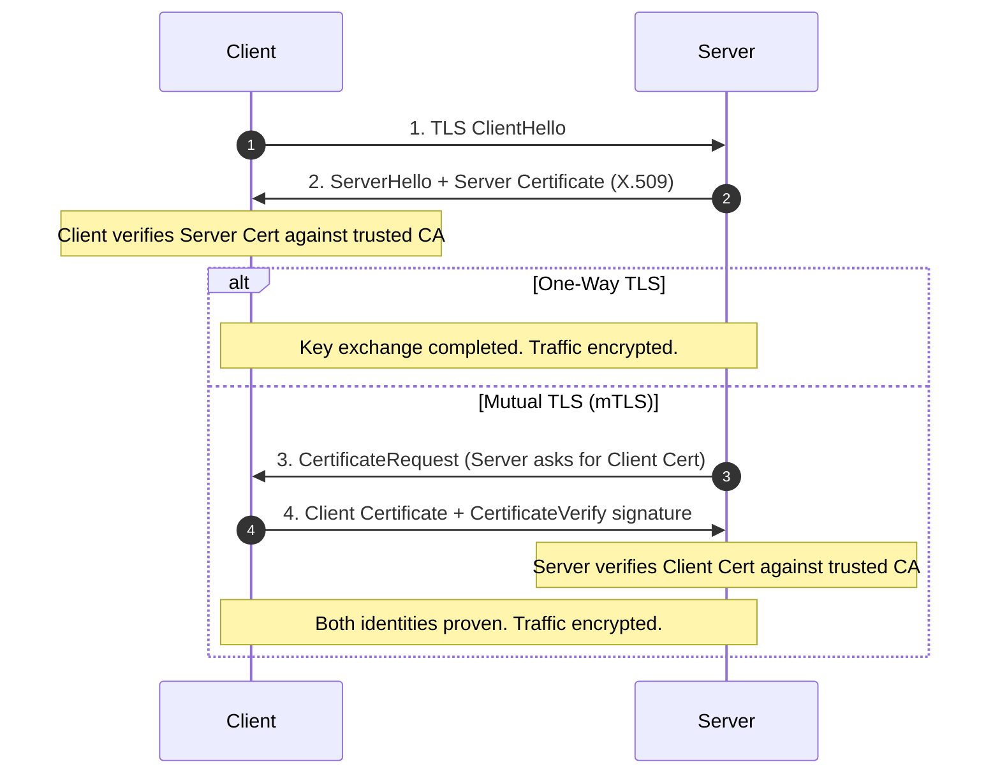

# Lesson 11: TLS and Security

In this lesson, you will master encryption in transit and transport-layer authentication using **TLS (Transport Layer Security)** and **Mutual TLS (mTLS)** in gRPC.

---

## 1. The Problem Being Solved

By default, local development uses insecure credentials (`grpc.credentials.createInsecure()`).
In production:
- Plaintext traffic exposes sensitive customer records, API keys, and passwords to packet sniffing and man-in-the-middle (MITM) attacks.
- Without mutual authentication, rogue pods or unauthorized services in a Kubernetes cluster can impersonate internal microservices.
- Zero-trust architecture mandates that all east-west (service-to-service) network traffic must be encrypted and cryptographically authenticated.

---

## 2. One-Way TLS vs Mutual TLS (mTLS)



---

## 3. Implementation Details

### Generating Certificates
We provide `generate-certs.ts` which uses Node.js cryptography to produce:
- `ca.crt`: Certificate Authority root
- `server.crt` & `server.key`: Server certificate and RSA private key
- `client.crt` & `client.key`: Client certificate and RSA private key (for mTLS)

### Server Setup (`server.ts`)
```typescript
import * as grpc from '@grpc/grpc-js';

const rootCert = fs.readFileSync('certs/ca.crt');
const serverCert = fs.readFileSync('certs/server.crt');
const serverKey = fs.readFileSync('certs/server.key');

// requireClientCert: true enforces mTLS
const serverCreds = grpc.ServerCredentials.createSsl(
  rootCert,
  [{ cert_chain: serverCert, private_key: serverKey }],
  true, // checkClientCertificate
);

server.bindAsync('127.0.0.1:50051', serverCreds, callback);
```

### Client Setup (`client.ts`)
```typescript
const rootCert = fs.readFileSync('certs/ca.crt');
const clientCert = fs.readFileSync('certs/client.crt');
const clientKey = fs.readFileSync('certs/client.key');

// createSsl(rootCert, clientPrivateKey, clientCertChain)
const channelCreds = grpc.credentials.createSsl(rootCert, clientKey, clientCert);

const client = new GreeterClient('127.0.0.1:50051', channelCreds, {
  'grpc.ssl_target_name_override': 'localhost',
});
```

---

## 4. How to Run

Generate certificates:
```bash
npx tsx lessons/11-tls-and-security/generate-certs.ts
```

Run secure client:
```bash
npx tsx lessons/11-tls-and-security/client.ts
```

---

## 5. Expected Output

```
🔒 Encrypted TLS Response: Secure TLS Hello, SecureAlice!
```

---

## 6. Common Mistakes

1. **Host/Domain mismatch (`CERTIFICATE_VERIFY_FAILED`)**:
   TLS verifies that the hostname in the target URL matches the `CN` (Common Name) or `SAN` (Subject Alternative Name) in the server certificate. In tests connecting to `127.0.0.1`, provide `'grpc.ssl_target_name_override': 'localhost'` if the certificate was issued to `localhost`.
2. **Disabling Certificate Verification in Production**:
   Never bypass certificate checks (e.g. `NODE_TLS_REJECT_UNAUTHORIZED=0`) in production environments. It completely defeats the cryptographic guarantees of TLS.
3. **Committing Private Keys to Git**:
   Never commit `.key` files containing private RSA/ECDSA keys to source control. Use environment secrets or secret managers (e.g. HashiCorp Vault, AWS Secrets Manager).

---

## 7. Exercises

1. **Verify Certificate Expiration**: Check how `@grpc/grpc-js` behaves when a certificate has expired.
2. **grpcurl with TLS**: Invoke the secure server from `grpcurl` passing `--cacert`, `--cert`, and `--key`:
   ```bash
   grpcurl -cacert certs/ca.crt -cert certs/client.crt -key certs/client.key 127.0.0.1:50051 helloworld.Greeter/SayHello
   ```

---

## 8. Interview Questions with Answers

### Q1: What is the primary difference between ALPN in HTTP/2 and HTTP/1.1 over TLS?
**Answer**:
Application-Layer Protocol Negotiation (ALPN) is a TLS extension negotiated during the initial TLS handshake. In gRPC over TLS, the client includes the ALPN token `h2`, informing the server that HTTP/2 framing is requested immediately upon TLS completion, eliminating an extra round-trip protocol upgrade step.

### Q2: Why is mTLS especially popular for service meshes (e.g. Istio, Linkerd)?
**Answer**:
Service meshes use sidecar proxies (like Envoy) running alongside application containers. The proxies automatically manage certificate rotation, mutual TLS encryption, and cryptographic service identity (SPIFFE IDs) across all network hops without individual application developers needing to write custom TLS certificate loading code in each programming language.
