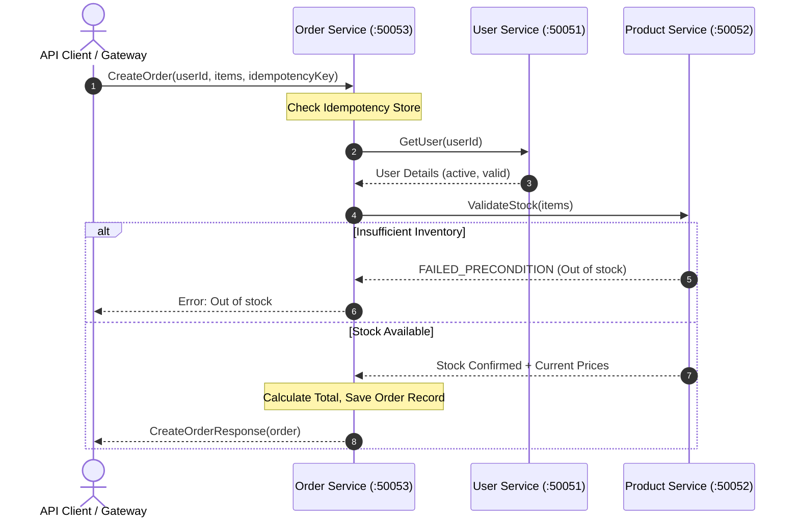

# Lesson 18: Integrated Microservices Architecture (`grpc-commerce-demo`)

## 1. Overview

In modern cloud architectures, microservices rarely operate in isolation. They communicate via low-latency Remote Procedure Calls to exchange data, enforce domain rules, and orchestrate business operations.

This lesson implements `grpc-commerce-demo`, an end-to-end e-commerce order processing system composed of three decoupled Node.js services communicating strictly over gRPC using Protocol Buffers:

1. **User Service** (Port `50051`): Account management, user query, and profile verification.
2. **Product Service** (Port `50052`): Product catalog, inventory stock validation, and reservation.
3. **Order Service** (Port `50053`): Order orchestration, downstream gRPC aggregation, idempotency checking, and checkout workflow.

---

## 2. Architecture & Service Topology



---

## 3. Distributed Systems Considerations

### A. Fallacy of Distributed Transactions
Calling multiple gRPC services inside a single request does not automatically create an ACID database transaction. If the User check succeeds and Product validation passes, but Order persistence crashes, partial state can emerge.

### B. The Saga Pattern & Compensating Transactions
For critical operations spanning multiple services:
- **Choreography-based Sagas**: Services emit events to message brokers (e.g., Kafka, RabbitMQ) and downstream consumers react.
- **Orchestration-based Sagas**: A central coordinator (the Order Service here) dispatches synchronous gRPC calls. If step 3 fails, the orchestrator issues compensating calls (e.g., `ReleaseInventoryReservation`).

### C. Idempotency Keys
Network partitions and timeouts can cause clients to retry requests that the server already executed. Using client-generated `idempotency_key` tokens prevents duplicate charge or duplicate order creation.

---

## 4. Running the Microservices

### Step 1: Start All Services in One Process (or Independent Terminals)
```bash
npm run microservices:start
```

Output:
```
🚀 Starting grpc-commerce-demo Microservices Cluster...
✅ User Service:    127.0.0.1:50051
✅ Product Service: 127.0.0.1:50052
✅ Order Service:   127.0.0.1:50053

Run the demo client in another terminal:
  npm run microservices:client
```

### Step 2: Run the Demo Client in a Second Terminal
```bash
npm run microservices:client
```

Expected Output:
```
--- 1. Querying User Service ---
Found buyer: Alice Dev (usr_alice_01)

--- 2. Querying Product Service ---
Found product: Mechanical Keyboard - Price: $129.99 (Stock: 15)

--- 3. Creating Order via Order Service (Orchestrator) ---
Order Placed: ID=ord_..., Total=$259.98

--- 4. Testing Idempotency (Replaying same order with same key) ---
Idempotent Match: Same Order ID returned -> ord_...

--- 5. Negative Test: Requesting Insufficient Stock ---
Caught expected business failure: [FAILED_PRECONDITION] Insufficient stock for Mechanical Keyboard: requested 9999, available 15
```

---

## 5. PostgreSQL Persistence Extension

In production, replace in-memory maps (`new Map()`) with a pooled PostgreSQL client (`pg.Pool`):
- Store users in a `users` table.
- Store products and inventory in a `products` table using row-level locking (`SELECT ... FOR UPDATE`) during inventory reservations.
- Store orders and order items in relational tables with foreign keys and unique constraints on `idempotency_key`.
